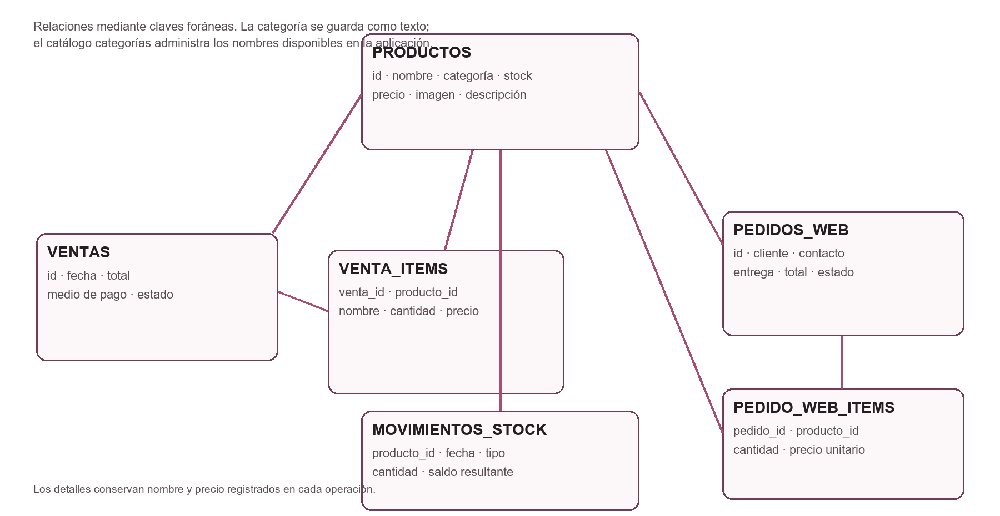
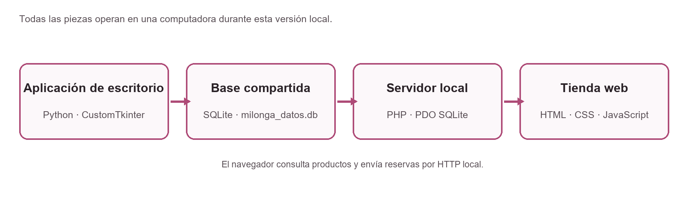

# Milonga Bazar

## Informe del proyecto y documentación técnica

Versión local para una computadora

Institución: EESTN5

Curso: 7mo 2da

Docente responsable: Gustavo Gómez

Autores: Alan González y Selena Ruiz Díaz

Fecha de documentación: 23 de noviembre de 2026

### Contenido

- 1 Resumen del proyecto
- 2 Fundamentación
- 3 Objetivos
  - 3.1 Objetivo general
  - 3.2 Objetivos específicos
- 4 Metas y alcance
- 5 Relevamiento de necesidades
- 6 Planificación y organización
- 7 Diseño del sistema
  - 7.1 Casos de uso
  - 7.2 Modelo de datos
  - 7.3 Arquitectura local
- 8 Desarrollo técnico
  - 8.1 Tecnologías
  - 8.2 Organización del código
  - 8.3 Integridad y validaciones
  - 8.4 Balance y egresos
- 9 Acceso y funcionamiento
- 10 Interfaz y experiencia de uso
  - 10.1 Aplicación de escritorio
  - 10.2 Tienda web
  - 10.3 Portada y accesibilidad
- 11 Ayuda y manual de uso
- 12 Beneficiarios
- 13 Localización y cobertura
- 14 Recursos necesarios
- 15 Evaluación y verificación
  - 15.1 Criterios de aceptación
- 16 Conclusión
- 17 Registro del proceso y aprendizajes
- 18 Fuentes
- 19 Anexos
  - 19.1 Estructura de carpetas
  - 19.2 Cobertura de pruebas de datos

# 1 Resumen del proyecto

Milonga Bazar integra una aplicación de escritorio para administrar inventario con una tienda web local para consultar productos y enviar solicitudes de reserva. Ambas partes trabajan sobre una misma base SQLite en la computadora del local. La aplicación registra ingresos, ajustes, ventas, reservas y gastos; la tienda presenta stock disponible y comunica los pedidos al área de ventas.

La versión documentada no procesa pagos ni está publicada en Internet. Su alcance actual es una demostración y operación local en una sola computadora. El sistema incluye controles transaccionales de stock, historial de movimientos, imágenes de producto, balance mensual de ingresos y egresos, y una configuración para personalizar la portada y la dirección del local.

El cierre de esta revisión deja implementadas las funciones principales de inventario, reservas, balance mensual y registro de gastos, junto con mejoras de identidad visual y un manual de operación. La tienda web incluye enlaces a las redes sociales del local.

# 2 Fundamentación

Un bazar necesita responder con rapidez qué productos hay, cuánto queda, qué precio se comunica y qué operaciones modificaron el saldo. Cuando el inventario y la tienda se mantienen separados, pueden aparecer diferencias entre lo publicado y lo disponible.

El sistema centraliza productos, categorías, ventas y solicitudes en SQLite. La aplicación de escritorio permite cargar mercadería y registrar operaciones; la tienda local permite que el cliente consulte el catálogo y prepare una reserva. La base compartida hace que las reservas descuenten las unidades antes de su preparación.

# 3 Objetivos

## 3.1 Objetivo general

Desarrollar y documentar una solución local para Milonga Bazar que conecte la gestión de inventario con un catálogo web y permita registrar ventas y solicitudes de reserva manteniendo consistencia en los datos y el stock.

## 3.2 Objetivos específicos

- Centralizar productos, categorías, precios, stock e imágenes en SQLite.
- Facilitar la búsqueda y el alta o reposición de productos desde la aplicación de escritorio.
- Registrar ventas presenciales con sus artículos y medio de pago, y conservar su historial.
- Publicar un catálogo local que lea los datos vigentes y permita enviar solicitudes de reserva.
- Evitar ventas y reservas por encima del stock disponible mediante validaciones y transacciones.
- Gestionar preparación, entrega y cancelación de reservas, reponiendo stock una sola vez al cancelar.
- Calcular el balance mensual de ingresos y egresos con trazabilidad de costos históricos.
- Mejorar legibilidad, identidad visual y personalización de la tienda.

# 4 Metas y alcance

| Área | Alcance implementado |
| --- | --- |
| Inventario | Alta y reposición, búsqueda, edición, categorías, imágenes, avisos y movimientos de stock. |
| Ventas locales | Carrito de mostrador, medio de pago, detalle de artículos, descuento de stock e historial con anulación. |
| Tienda local | Catálogo, búsqueda, filtros, carrito y formulario de reserva sin cobro online. |
| Pedidos | Registro del detalle, estado operativo, consulta desde la app y cancelación con restitución única. |
| Balance | Resumen mensual de ingresos y egresos para los últimos 3 meses, con registro de gastos manuales. |
| Identidad del local | Logo Milonga, botón +, dirección en tienda.json, portada seleccionable y enlaces a redes sociales. |
| Operación | Ejecución en una PC, con Python, PHP y una base SQLite compartida. |

Quedan fuera de alcance el alojamiento público, el acceso desde varias computadoras, la sincronización remota, los pagos online, la facturación fiscal, los usuarios con permisos y la conexión con medios de pago.

# 5 Relevamiento de necesidades

| Necesidad | Respuesta del sistema | Criterio de aceptación |
| --- | --- | --- |
| Encontrar productos | Búsqueda en stock y para ventas; sugerencias en Ingresos. | Reconocer un producto existente y reducir duplicados por variaciones de escritura. |
| Evitar diferencias de stock | Movimientos, validación de saldo y transacciones. | El saldo no puede ser negativo y la operación se confirma completa. |
| Organizar el catálogo | Categorías administrables, descripción e imagen opcional. | Los artículos publicados cuentan con precio y disponibilidad. |
| Atender pedidos | Formulario con contacto, entrega, comentario y productos. | La solicitud se guarda con detalle y estado, sin cobrar. |
| Conocer el resultado económico | Balance mensual con ingresos, egresos y gastos manuales. | Los cálculos excluyen operaciones anuladas o canceladas y usan el costo histórico de cada ingreso. |
| Agilizar la operación | Escala A+/A−, contraste, foco visible y acciones reconocibles. | El personal puede leer y operar sin depender de etiquetas ambiguas. |

La necesidad de escribir "vincha" o "vinchas" sin crear registros duplicados motivó sugerencias y autocompletado de datos del producto conocido. La coincidencia textual ayuda a la carga; el modelo permite distinguir artículos por categoría.

# 6 Planificación y organización

El trabajo se organizó en etapas dependientes. Primero se revisaron la aplicación y los datos; después se definió la base común y se conectaron los flujos de inventario y venta; luego se incorporaron catálogo y reservas; finalmente se atendieron balance, accesibilidad, identidad visual, documentación y validaciones.

| Etapa | Trabajo | Resultado |
| --- | --- | --- |
| 1 Diagnóstico | Revisar código, base, arranque y alcance local. | Mapa de componentes y riesgos de datos. |
| 2 Datos | Compartir SQLite y agregar migraciones, categorías y movimientos. | Persistencia común sin borrar productos existentes. |
| 3 Operación | Ingresos, reposiciones, stock, avisos, ventas e historial. | Flujos de mostrador respaldados por la base. |
| 4 Catálogo | API, catálogo, carrito, reserva y estados del pedido. | Solicitud validada contra el stock vigente. |
| 5 Balance | Costo histórico en movimientos, tabla gastos, vista Balance. | Resumen mensual sin recalcular costos actuales. |
| 6 Experiencia | Sugerencias, fotos, escala, colores, marca y redes sociales. | Interacción más rápida y legible. |
| 7 Entrega | Manual, instrucciones de inicio, límites y revisión. | Material para operar y continuar el proyecto. |

El material disponible no registra un cronograma calendario ni responsabilidades individuales verificables. Por eso se documenta la secuencia de etapas sin asignar fechas ni atribuir tareas personales.

# 7 Diseño del sistema

## 7.1 Casos de uso

| Actor | Acciones principales |
| --- | --- |
| Personal del local | Administrar productos y categorías; actualizar stock y precios; adjuntar fotos; registrar y anular ventas; revisar y cambiar estados de pedidos; registrar gastos; consultar el balance mensual. |
| Cliente | Buscar y filtrar productos; ver disponibilidad; preparar un carrito; enviar una reserva con contacto y modalidad de entrega. |
| Sistema | Calcular importes desde la base; validar cantidades y stock; guardar el detalle; registrar movimientos con costo histórico; rechazar operaciones inconsistentes. |

La versión no implementa inicio de sesión. La tienda no cobra ni confirma por sí sola la entrega. El local debe contactar a la persona que solicita una reserva.

## 7.2 Modelo de datos

Figura 1. Entidades y relaciones principales implementadas en SQLite.

productos contiene nombre, categoría, cantidades, precios y referencias opcionales a imagen y descripción. categorias evita nombres repetidos en la lista de alta, aunque el producto conserva la categoría como texto y no como clave foránea. ventas y venta_items guardan ventas locales; pedidos_web y pedido_web_items guardan solicitudes y detalles; movimientos_stock registra ingresos, ventas, reservas, cancelaciones y ajustes, con la columna costo_unitario para los ingresos de mercadería; gastos guarda egresos manuales con fecha, descripción e importe.

Las migraciones detectan columnas faltantes y las agregan sin borrar el inventario existente. Las operaciones que cambian unidades usan transacciones y restricciones de cantidad. Los detalles retienen el nombre y el precio unitario de la operación para conservar el historial.

## 7.3 Arquitectura local

Figura 2. Comunicación local entre la aplicación, la base de datos y el catálogo.

La aplicación Python y el servidor PHP resuelven la misma base mediante rutas basadas en la ubicación de sus archivos, no en la carpeta actual de la consola. El navegador consume api.php: una consulta GET entrega productos y un POST registra reservas. PHP usa PDO SQLite y Python usa sqlite3. El servidor escucha en 127.0.0.1:8000 y no debe exponerse a Internet.

La hoja de estilos intenta cargar tipografías de Google Fonts y define fuentes de reemplazo. Por eso el navegador puede realizar una solicitud externa de tipografías si hay conexión; el catálogo, la base y las reservas siguen en la computadora local.

# 8 Desarrollo técnico

## 8.1 Tecnologías

| Tecnología | Uso |
| --- | --- |
| Python 3 | Lógica de escritorio. |
| CustomTkinter | Controles gráficos y tema claro. |
| SQLite | Almacenamiento local compartido. |
| PHP y PDO SQLite | API local para catálogo y reservas. |
| HTML y CSS | Estructura, presentación y adaptación de la tienda. |
| JavaScript | Búsqueda, filtros, carrito y carga de catálogo. |
| Pillow | Redimensionado y guardado de imágenes cuando está instalado. |
| XAMPP PHP | Servidor local con php.exe -S. |
| Navegador moderno | Consulta y operación de la tienda. |

## 8.2 Organización del código

| Ruta | Responsabilidad |
| --- | --- |
| Sistema/App/main.py | Inicio, navegación y escala de interfaz. |
| Sistema/App/database.py | Esquema, migraciones, categorías, ventas, reservas, movimientos, gastos y balance. |
| Sistema/App/vista_stock.py | Pantalla de stock actual. |
| Sistema/App/vista_avisos.py | Pantalla de avisos de stock bajo. |
| Sistema/App/vista_ingresos.py | Pantalla de ingreso de mercadería. |
| Sistema/App/vista_ventas.py | Pantalla de ventas locales y pedidos web. |
| Sistema/App/vista_balance.py | Pantalla de balance mensual y registro de gastos. |
| Sistema/App/image_utils.py | Validación, optimización y copia de imágenes. |
| Sistema/App/store_config.py | Lectura y escritura de dirección y portada (usada por la tienda web). |
| Sistema/Web/api.php | Consulta de catálogo y creación de reservas. |
| Sistema/Web/app.js | Interacción web, carrito, filtros y estado de tienda. |
| Sistema/Web/index.html y styles.css | Pantallas, marca, paleta, layout y adaptación responsive. |
| Sistema/Web/tienda.json | Dirección y foto de portada del local. |
| Sistema/MANUAL-USUARIO.md y LEEME-LOCAL.txt | Procedimientos de operación y arranque. |

## 8.3 Integridad y validaciones

- Consultas parametrizadas y restricciones de claves foráneas.
- Transacciones para ventas, reservas y devoluciones.
- Validación del stock y del precio guardado en la base antes de registrar una reserva.
- Límites para textos, cantidades, extensiones y tamaño de imágenes.
- Validación de rutas de foto dentro de la carpeta uploads.
- Cancelación y anulación condicionadas al estado; la restitución se registra una vez.

## 8.4 Balance y egresos

La sección Balance muestra los últimos 3 meses calendario. Para cada mes calcula:

- Ingresos por ventas locales con estado Registrada (excluye Anuladas).
- Ingresos por pedidos web con estado Entregado (excluye Cancelados y pendientes).
- Egresos por compras: suma de `cantidad × costo_unitario` de los movimientos de ingreso. El costo se guarda en el momento del ingreso en la columna `costo_unitario` de `movimientos_stock`; no se recalcula desde `precio_compra` del producto, que puede cambiar. Los movimientos anteriores a esta versión tienen `costo_unitario NULL` y se excluyen del cálculo con un aviso visible en la interfaz.
- Egresos por gastos manuales registrados en la tabla `gastos`.

Las migraciones que agregan `costo_unitario` y la tabla `gastos` son aditivas y no modifican datos existentes.

# 9 Acceso y funcionamiento

La app se inicia desde Sistema/App; la tienda se sirve desde Sistema/Web. La URL local es http://127.0.0.1:8000/. No hay URL pública ni credenciales. Ambos procesos deben permanecer activos.

| Componente | Inicio local |
| --- | --- |
| Aplicación | cd D:\2026\Bazar\Sistema\App y python main.py |
| Servidor web | Otra consola: cd D:\2026\Bazar\Sistema\Web y C:\xampp\php\php.exe -S 127.0.0.1:8000 |
| Navegador | Abrir http://127.0.0.1:8000/ |
| Cierre | Detener PHP con Ctrl+C y cerrar la app. |

# 10 Interfaz y experiencia de uso

## 10.1 Aplicación de escritorio

La navegación lateral incluye Stock actual, Avisos, Ingresos, Ventas y Balance. La vista de ingresos propone coincidencias al escribir y puede completar datos de un producto existente; la cantidad se vuelve a ingresar para evitar sumar unidades sin confirmación. Las categorías se agregan desde Administrar categorías. A−/A+ cambia el tamaño de los controles y guarda la preferencia en preferencias.json.

## 10.2 Tienda web

La página presenta catálogo con búsqueda y filtros por categoría, tarjetas con precio y disponibilidad y acceso al carrito. El pie de página incluye enlaces a Facebook e Instagram del local. Encabezado y pie usan assets/logo-milonga.png. Los estilos se agruparon por componentes, paleta, layout responsive y ajustes de legibilidad.

## 10.3 Portada y accesibilidad

La dirección del local está configurada en tienda.json y se muestra en la sección de contacto de la tienda web. Para cambiar la foto de portada, se puede reemplazar el archivo en uploads y actualizar tienda.json. Si no hay foto, continúa la ilustración original.

Los formularios usan contraste oscuro sobre fondos claros, foco visible y tamaño ampliable. Esta revisión no sustituye una inspección interactiva de cada pantalla; el desplegable de categorías y la escala deben validarse en Windows.

# 11 Ayuda y manual de uso

El manual complementario explica arranque, carga y reposición, mantenimiento del catálogo, ventas, reservas, balance, gastos y respaldo. [Abrir el manual de usuario](../Manual/Manual%20de%20usuario%20Milonga%20Bazar.md). LEEME-LOCAL.txt ofrece comandos breves para iniciar.

# 12 Beneficiarios

- Personal de Milonga Bazar, que administra inventario localmente.
- Clientes que consultan el catálogo y envían una solicitud sin cuenta.
- Responsables del local, que reciben pedidos y siguen su preparación.

# 13 Localización y cobertura

La versión está limitada a la computadora que ejecuta Python y PHP. La tienda usa loopback y no es accesible desde otra PC o Internet en la configuración documentada. No se implementó sincronización entre cajas. El uso remoto exigiría un servicio central y una arquitectura de producción.

# 14 Recursos necesarios

| Tipo | Necesario |
| --- | --- |
| Físicos | Una PC con Windows y espacio para base y fotos. |
| Humanos | Una persona que administre inventario y responda reservas. |
| Software | Python 3, requirements.txt, PHP de XAMPP con PDO SQLite y navegador. |
| Datos | milonga_datos.db, tienda.json y toda la carpeta Web/uploads. |
| Económicos | No se identifican costos de alojamiento local; no se estiman horas o salarios sin datos reales. |

# 15 Evaluación y verificación

Sistema/App/tests/test_database.py contiene 22 pruebas organizadas en dos suites. `SharedDatabaseTests` cubre persistencia, validación, stock, reservas, ventas, movimientos, categorías y migración. `BalanceTests` cubre cálculos de balance por mes, exclusión de estados (anuladas, canceladas, no entregadas), egresos con y sin costo registrado, gastos manuales, validaciones de `registrar_gasto` e idempotencia de migraciones. Las 22 pruebas pasan. La suite cubre la lógica de datos; no valida por sí sola la interacción visual ni la instalación en cada PC.

| Estado | Hallazgo |
| --- | --- |
| Implementado | Inventario, categorías, fotos, ventas, reservas, gestión de pedidos, balance mensual, gastos manuales y redes sociales en la tienda web. |
| Reportado pendiente | Se recibió un TclError "invalid command name ...dropdownmenu" al usar A−/A+ durante una interacción de CustomTkinter. No se confirmó causa ni corrección. |
| Fuera de alcance | No se configuró publicación pública ni uso simultáneo desde varias computadoras. |

## 15.1 Criterios de aceptación

- Un ingreso nuevo crea un producto; una coincidencia permite cargar datos del existente y sumar el ingreso previsto.
- Una venta y una reserva descuentan solo unidades disponibles y dejan trazabilidad.
- Una cancelación o anulación devuelve unidades una sola vez.
- Artículos, importes y estados coinciden entre tienda y aplicación.
- El balance mensual excluye operaciones anuladas y canceladas, y usa el costo registrado en cada ingreso.
- Las fotos y preferencias se actualizan cuando los archivos están presentes.
- Los controles y menús se usan al tamaño elegido sin excepciones de interfaz.

# 16 Conclusión

El proyecto cubre el ciclo básico del bazar local: registrar mercadería, consultar stock, vender en el mostrador, recibir solicitudes desde un catálogo y revisar el resultado económico mensual. SQLite compartido mantiene las reservas vinculadas al inventario. Las operaciones importantes registran movimientos y validan disponibilidad antes de modificar los datos. El costo de cada ingreso queda guardado en el momento de la operación, lo que permite calcular egresos históricos correctos aunque el precio de compra cambie después.

Al retomar el desarrollo, conviene revisar la excepción de escala reportada, respaldar los datos antes de instalar cambios y validar las pantallas en una sesión real de Windows. La publicación en Internet requiere otra revisión de autenticación, privacidad, despliegue y arquitectura.

# 17 Registro del proceso y aprendizajes

El relevamiento de requerimientos mostró que el sistema debía funcionar en un contexto donde la disponibilidad de Wi-Fi no siempre está garantizada. El equipo aprendió a considerar esa condición al definir una modalidad local de trabajo, con inventario y catálogo en la misma computadora.

El proyecto también permitió trabajar con personas nuevas y desarrollar dos aplicaciones que utilizan una misma base de datos. La experiencia ayudó a comprender cómo se conectan componentes escritos en tecnologías distintas y por qué las operaciones de stock deben quedar registradas de forma consistente.

Las imágenes también forman parte del respaldo porque la base conserva sus rutas. Las pruebas automatizadas de datos deben complementarse con validaciones de las ventanas reales.

# 18 Fuentes

- Código: database.py, vistas de App, image_utils.py, store_config.py y main.py.
- Web: api.php, app.js, index.html, styles.css y tienda.json.
- Operación: MANUAL-USUARIO.md y LEEME-LOCAL.txt.
- Pruebas: Sistema/App/tests/test_database.py.
- Informe SCOREED existente, usado como guía de apartados. Sus autores, fechas y datos institucionales no se atribuyeron a Milonga Bazar.

# 19 Anexos

## 19.1 Estructura de carpetas

| Ruta | Contenido |
| --- | --- |
| Sistema/App/ | Aplicación Python, módulos y base SQLite. |
| Sistema/App/tests/ | Pruebas unitarias de datos. |
| Sistema/Web/ | API, interfaz web y configuración. |
| Sistema/Web/assets/ | Logo de Milonga. |
| Sistema/Web/uploads/ | Fotos de portada y productos. |
| Documentación/ | Informes, manuales y entregables. |

## 19.2 Cobertura de pruebas de datos

| Grupo | Escenarios |
| --- | --- |
| Productos | Alta, actualización y rechazo de datos inválidos. |
| Reservas | Agotado, cantidades fuera de rango, pedidos concurrentes, cancelación única y entrega. |
| Ventas | Registro atómico, falta de stock y anulación con restitución única. |
| Historial | Categorías, ajustes y movimientos. |
| Migración | Preservación de productos y ventas existentes; columna costo_unitario y tabla gastos. |
| Balance | Ventas locales incluidas/anuladas, pedidos entregados/pendientes/cancelados, egresos con y sin costo, gastos manuales, balance neto, mes sin datos. |
| Gastos | Registro correcto, validaciones de fecha/descripción/importe. |
